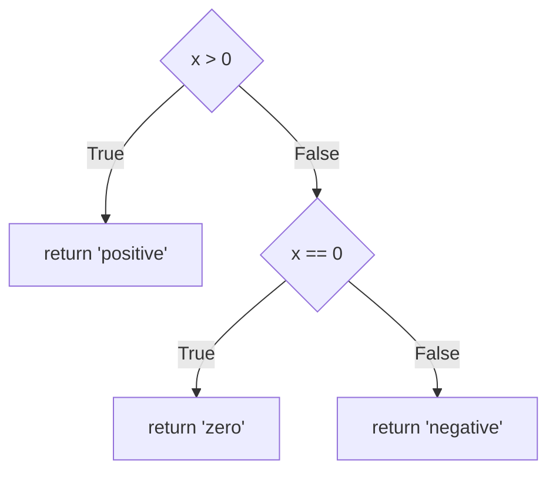
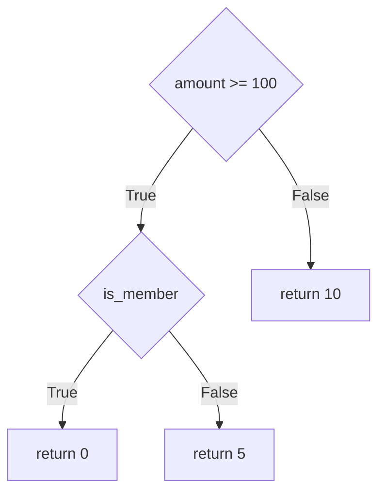
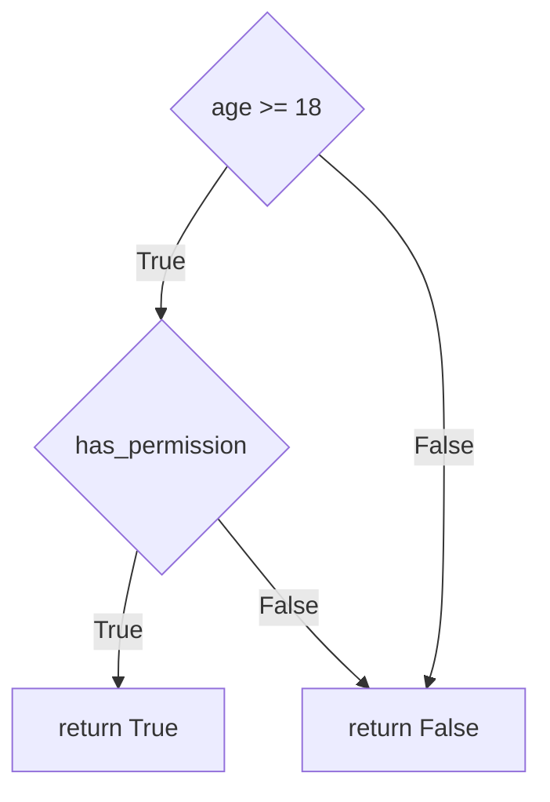
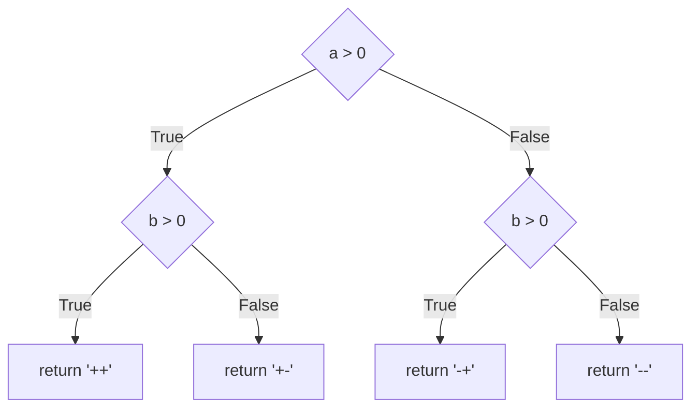
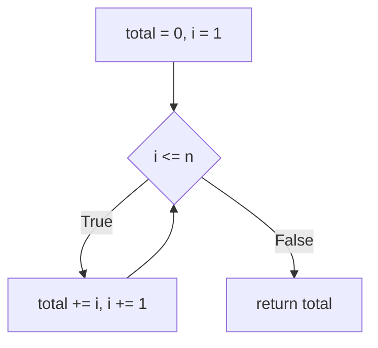
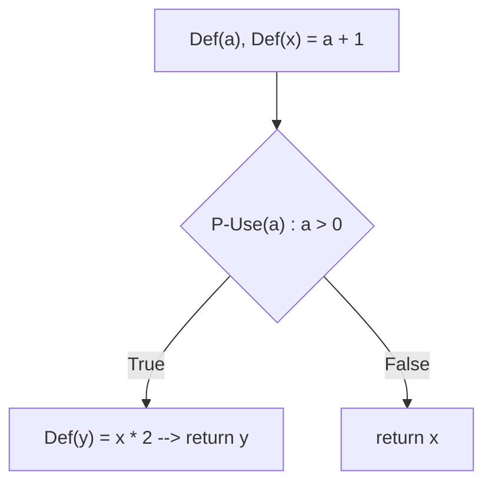

# Laporan Pengujian White Box Testing

| Identitas | Keterangan |
| :--- | :--- |
| **Nama Mahasiswa** | Sayyid Abdullah Azzam |
| **NIM** | 2023230021 |
| **Mata Kuliah** | Software Testing & Quality Assurance |
| **Tugas** | Tugas 1 Praktikum (White Box Testing) |

---

## 1. Ringkasan Eksekusi & Jumlah Kasus Uji

Pengujian dilakukan menggunakan **Pytest** dan **Coverage.py** terhadap 6 modul pengujian struktural (*White Box Testing*).

- **Total Modul:** 6 Modul
- **Total Kasus Uji (Test Cases):** 20 Kasus Uji
- **Hasil Eksekusi:** 20 Lulus (Passed), 0 Gagal (Failed) — **Tingkat Kelulusan: 100%**
- **Statement Coverage:** 100% (37 / 37 Pernyataan)
- **Branch Coverage:** 100% (20 / 20 Percabangan)

### Ringkasan Jumlah Case per Modul
| No | Modul Sumber | Berkas Pengujian | Fungsi yang Diuji | Metode Pengujian | Jumlah Case | Status |
|:--:|---|---|---|---|:--:|:--:|
| 1 | `source/statements.py` | `test/test_statements.py` | `sign_label` | Statement Coverage | 3 Case | **PASS** |
| 2 | `source/branches.py` | `test/test_branches.py` | `fee` | Branch Coverage | 3 Case | **PASS** |
| 3 | `source/conditions.py` | `test/test_conditions.py` | `eligible` | Condition Coverage | 4 Case | **PASS** |
| 4 | `source/paths.py` | `test/test_paths.py` | `classify` | Basis Path Testing | 4 Case | **PASS** |
| 5 | `source/loops.py` | `test/test_loops.py` | `sum_first` | Loop Testing | 4 Case | **PASS** |
| 6 | `source/dataflow.py` | `test/test_dataflow.py` | `compute` | Data Flow Testing | 2 Case | **PASS** |
| **TOTAL** | | | | | **20 Case** | **ALL PASSED** |

---

## 2. Rincian Kasus Uji & Hasil Pengujian per Modul

### 2.1 Statement Coverage
- **File:** `source/statements.py` & `test/test_statements.py`
- **Fungsi:** `sign_label(x)`
- **Jumlah Kasus Uji:** 3 Case

```python
def sign_label(x):
    if x > 0:
        return "positive"
    if x == 0:
        return "zero"
    return "negative"
```



**Tabel Hasil Pengujian:**
| Test Case ID | Test Function | Input (`x`) | Expected Output | Actual Output | Baris Tereksekusi | Status |
|:---:|---|:---:|:---:|:---:|:---:|:---:|
| TC-STMT-01 | `test_positive` | `5` | `"positive"` | `"positive"` | Baris 3, 4 | **PASS** |
| TC-STMT-02 | `test_zero` | `0` | `"zero"` | `"zero"` | Baris 3, 5, 6 | **PASS** |
| TC-STMT-03 | `test_negative` | `-3` | `"negative"` | `"negative"` | Baris 3, 5, 7 | **PASS** |

---

### 2.2 Branch Coverage
- **File:** `source/branches.py` & `test/test_branches.py`
- **Fungsi:** `fee(amount, is_member)`
- **Jumlah Kasus Uji:** 3 Case (Mencakup 4 cabang keputusan)

```python
def fee(amount, is_member):
    if amount >= 100:
        if is_member:
            return 0
        else:
            return 5
    else:
        return 10
```



**Tabel Hasil Pengujian:**
| Test Case ID | Test Function | Input (`amount`, `is_member`) | Cabang yang Diuji | Expected | Actual | Status |
|:---:|---|:---:|---|:---:|:---:|:---:|
| TC-BR-01 | `test_big_member` | `150, True` | amount $\ge 100$ (True) & is_member (True) | `0` | `0` | **PASS** |
| TC-BR-02 | `test_big_nonmember` | `150, False` | amount $\ge 100$ (True) & is_member (False) | `5` | `5` | **PASS** |
| TC-BR-03 | `test_small` | `50, False` | amount $\ge 100$ (False) | `10` | `10` | **PASS** |

---

### 2.3 Condition Coverage
- **File:** `source/conditions.py` & `test/test_conditions.py`
- **Fungsi:** `eligible(age, has_permission)`
- **Jumlah Kasus Uji:** 4 Case (Seluruh kombinasi $2^2$ tabel kebenaran)

```python
def eligible(age, has_permission):
    if age >= 18 and has_permission:
        return True
    return False
```



**Tabel Hasil Pengujian:**
| Test Case ID | Test Function | Input (`age`, `has_permission`) | Evaluasi Logika ($C_1 \land C_2$) | Expected | Actual | Status |
|:---:|---|:---:|:---:|:---:|:---:|:---:|
| TC-COND-01 | `test_both_true` | `20, True` | True and True $\rightarrow$ True | `True` | `True` | **PASS** |
| TC-COND-02 | `test_age_true_perm_false` | `20, False` | True and False $\rightarrow$ False | `False` | `False` | **PASS** |
| TC-COND-03 | `test_age_false_perm_true` | `17, True` | False and True $\rightarrow$ False | `False` | `False` | **PASS** |
| TC-COND-04 | `test_both_false` | `17, False` | False and False $\rightarrow$ False | `False` | `False` | **PASS** |

---

### 2.4 Basis Path Testing
- **File:** `source/paths.py` & `test/test_paths.py`
- **Fungsi:** `classify(a, b)`
- **Jumlah Kasus Uji:** 4 Case ($V(G) = 4$ jalur independen linier)

```python
def classify(a, b):
    if a > 0:
        if b > 0:
            return "++"
        else:
            return "+-"
    else:
        if b > 0:
            return "-+"
        else:
            return "--"
```



**Tabel Hasil Pengujian:**
| Test Case ID | Test Function | Input (`a`, `b`) | Jalur Independen Basis | Expected | Actual | Status |
|:---:|---|:---:|---|:---:|:---:|:---:|
| TC-PATH-01 | `test_pp` | `1, 1` | Jalur 1: $a > 0 \rightarrow b > 0$ | `"++"` | `"++"` | **PASS** |
| TC-PATH-02 | `test_pn` | `1, -1` | Jalur 2: $a > 0 \rightarrow b \le 0$ | `"+-"` | `"+-"` | **PASS** |
| TC-PATH-03 | `test_np` | `-1, 1` | Jalur 3: $a \le 0 \rightarrow b > 0$ | `"-+"` | `"-+"` | **PASS** |
| TC-PATH-04 | `test_nn` | `-2, -3` | Jalur 4: $a \le 0 \rightarrow b \le 0$ | `"--"` | `"--"` | **PASS** |

---

### 2.5 Loop Testing
- **File:** `source/loops.py` & `test/test_loops.py`
- **Fungsi:** `sum_first(n)`
- **Jumlah Kasus Uji:** 4 Case (Bypass, Single, Multiple, Negative Boundary)

```python
def sum_first(n):
    total = 0
    i = 1
    while i <= n:
        total += i
        i += 1
    return total
```



**Tabel Hasil Pengujian:**
| Test Case ID | Test Function | Input (`n`) | Skenario Iterasi | Expected | Actual | Status |
|:---:|---|:---:|---|:---:|:---:|:---:|
| TC-LOOP-01 | `test_zero` | `0` | 0 iterasi (Bypass loop langsung) | `0` | `0` | **PASS** |
| TC-LOOP-02 | `test_one` | `1` | 1 iterasi (Single iteration) | `1` | `1` | **PASS** |
| TC-LOOP-03 | `test_five` | `5` | 5 iterasi (Multiple: 1+2+3+4+5) | `15` | `15` | **PASS** |
| TC-LOOP-04 | `test_negative` | `-2` | Nilai batas negatif (0 iterasi) | `0` | `0` | **PASS** |

---

### 2.6 Data Flow Testing
- **File:** `source/dataflow.py` & `test/test_dataflow.py`
- **Fungsi:** `compute(a)`
- **Jumlah Kasus Uji:** 2 Case (Mencakup seluruh DU-Chains & Def-Clear Paths)

```python
def compute(a):
    x = a + 1
    if a > 0:
        y = x * 2
        return y
    return x
```



**Tabel Hasil Pengujian:**
| Test Case ID | Test Function | Input (`a`) | Pasangan Def-Use yang Diuji | Expected | Actual | Status |
|:---:|---|:---:|---|:---:|:---:|:---:|
| TC-DF-01 | `test_positive_returns_y` | `5` | `Def(a) -> Use(a, x=a+1) -> P-Use(a>0:True) -> Def(y=x*2) -> Return y` | `12` | `12` | **PASS** |
| TC-DF-02 | `test_nonpositive_returns_x` | `-1` | `Def(a) -> Use(a, x=a+1) -> P-Use(a>0:False) -> Return x` | `0` | `0` | **PASS** |

---

## 3. Log Eksekusi & Laporan Code Coverage

### 3.1 Terminal Output Eksekusi Pytest
```text
============================= test session starts =============================
platform win32 -- Python 3.14.7, pytest-9.1.1, pluggy-1.7.0
rootdir: .
collected 20 items

test_branches.py::test_big_member PASSED                                 [  5%]
test_branches.py::test_big_nonmember PASSED                              [ 10%]
test_branches.py::test_small PASSED                                      [ 15%]
test_conditions.py::test_both_true PASSED                                [ 20%]
test_conditions.py::test_age_true_perm_false PASSED                      [ 25%]
test_conditions.py::test_age_false_perm_true PASSED                      [ 30%]
test_conditions.py::test_both_false PASSED                               [ 35%]
test_dataflow.py::test_positive_returns_y PASSED                         [ 40%]
test_dataflow.py::test_nonpositive_returns_x PASSED                      [ 45%]
test_loops.py::test_zero PASSED                                          [ 50%]
test_loops.py::test_one PASSED                                           [ 55%]
test_loops.py::test_five PASSED                                          [ 60%]
test_loops.py::test_negative PASSED                                      [ 65%]
test_paths.py::test_pp PASSED                                            [ 70%]
test_paths.py::test_pn PASSED                                            [ 75%]
test_paths.py::test_np PASSED                                            [ 80%]
test_paths.py::test_nn PASSED                                            [ 85%]
test_statements.py::test_positive PASSED                                 [ 90%]
test_statements.py::test_zero PASSED                                     [ 95%]
test_statements.py::test_negative PASSED                                 [100%]

============================= 20 passed in 0.15s ==============================
```

### 3.2 Laporan Cakupan Kode (Coverage Report)
```text
Name            Stmts   Miss Branch BrPart  Cover   Missing
-----------------------------------------------------------
branches.py         6      0      4      0   100%
conditions.py       4      0      2      0   100%
dataflow.py         6      0      2      0   100%
loops.py            7      0      2      0   100%
paths.py            8      0      6      0   100%
statements.py       6      0      4      0   100%
-----------------------------------------------------------
TOTAL              37      0     20      0   100%
```

---

## 4. Perbandingan Karakteristik 6 Teknik White Box

| Teknik | Fokus Pengujian | Jumlah Kasus Uji | Kelebihan Utama | Kelemahan |
|---|---|:---:|---|---|
| **Statement Coverage** | Setiap baris kode | 3 Case | Cepat & mendeteksi *dead code*. | Tidak menguji cabang keputusan kosong. |
| **Branch Coverage** | Cabang True/False | 3 Case | Menjamin setiap cabang arah keputusan diuji. | Tidak menguji kombinasi sub-kondisi majemuk. |
| **Condition Coverage** | Sub-kondisi Boolean | 4 Case | Menguji kombinasi kondisi atomik ($2^n$). | Jumlah kasus uji melonjak pada kondisi rumit. |
| **Basis Path Testing** | Jalur independen linier | 4 Case | Terukur secara matematis ($V(G)$). | Sulit jika kombinasi jalur sangat banyak. |
| **Loop Testing** | Mekanisme perulangan | 4 Case | Menemukan bug *off-by-one* dan loop tak berhingga. | Terbatas pada konstruksi perulangan. |
| **Data Flow Testing** | Siklus variabel (Def-Use) | 2 Case | Menemukan variabel belum terdefinisi / terbuang. | Memerlukan analisis statis yang teliti. |

---

## 5. Kesimpulan

1. Dari 6 modul yang diuji, total diterapkan **20 kasus uji (*test cases*)**.
2. Seluruh 20 kasus uji berhasil lulus (**100% Passed**, 0 Failures).
3. Hasil pengukuran cakupan kode mencapai **100% Statement Coverage** dan **100% Branch Coverage** di seluruh modul tanpa ada baris atau percabangan yang terlewat.
